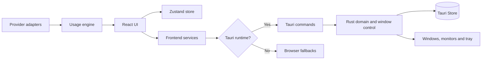

# Notch Island - technical documentation

This document is for people who build, maintain and extend Notch Island. It explains the current architecture, the local development workflow and the decisions that keep the product aligned with its core idea.

For the product story, positioning and download link, see the [main README](README.md).

<p>
  
  
  
</p>

## Technical direction

Notch Island is a desktop companion for AI usage awareness. The technical foundation is intentionally split into two layers:

- a visual layer that should feel calm, responsive and easy to personalize;
- a native layer that owns desktop behavior, window geometry, persistence and system integration.

The boundary matters. Product behavior should remain understandable in the frontend, while operating-system behavior should remain deterministic in Rust. New capabilities should preserve that separation.

## Current status

The project is an MVP.

### Available today

- guided onboarding;
- provider selection UI;
- transparent always-on-top widget;
- compact usage view with provider details;
- placement on the top, bottom, left or right edge;
- multi-monitor support, including negative coordinates and DPI scaling;
- widget position restoration between runs;
- visual themes, surfaces, fonts and provider colors;
- Windows startup option;
- single-instance behavior and system-tray controls;
- browser preview for interface work.

### Intentionally not complete yet

- live provider integrations;
- provider authentication and credential management;
- native limit and renewal notifications;
- shared persistence for every visual preference across windows;
- production support promises for macOS or Linux.

The current provider data is mocked. It must never be presented as real account usage.

## Architecture at a glance



### Frontend

The React application owns presentation, onboarding, settings, widget composition and deterministic usage states. Components should call services instead of invoking Tauri commands directly.

Relevant areas include:

| Area | Responsibility |
| --- | --- |
| `src/app/` | Application bootstrap, window routing and shared state |
| `src/onboarding/` | First-run experience and setup flow |
| `src/widget/` | Island layout, flyout, interactions and placement UI |
| `src/settings/` | Preferences and provider selection |
| `src/providers/` | Provider contracts, adapters and service registration |
| `src/usage/` | Usage snapshots, limits and deterministic calculations |
| `src/notchi/` | Mascot states and visual interpretation of usage |
| `src/shared/` | Reusable services, components and icons |

### Native layer

The Tauri/Rust layer owns the parts of the experience that depend on the operating system:

- window creation, movement, sizing and visibility;
- monitor work areas, DPI conversion and bounds clamping;
- persistence of onboarding and widget placement;
- startup behavior and system-tray actions;
- single-instance coordination;
- the command surface exposed to the frontend.

The native layer is the source of truth for geometry. CSS measurements are inputs to the placement process, not absolute desktop coordinates.

## Windows and responsibilities

| Label | Initial state | Responsibility |
| --- | --- | --- |
| `onboarding` | Visible on first run | Product setup and first-run configuration |
| `widget` | Hidden until setup is complete | Transparent, always-on-top island |
| `settings` | Hidden | Visual preferences, placement and providers |
| `placement` | Created on demand | Transparent placement overlay |
| `main` | Hidden/reserved | Future product surface |

In browser preview, a window can be simulated with the `window` query parameter:

```text
http://localhost:1420/?window=onboarding
http://localhost:1420/?window=widget
http://localhost:1420/?window=settings
http://localhost:1420/?window=placement
```

Browser preview is useful for visual work. It does not reproduce native window movement, tray behavior, startup registration or Tauri Store guarantees.

## Provider model

Provider integrations are behind a small domain contract so the interface does not depend on any provider's response format.

```ts
interface AIProvider {
  id: string;
  name: string;
  icon?: string;
  color?: string;
  fetchUsage(): Promise<UsageSnapshot>;
  fetchLimits(): Promise<UsageLimit[]>;
}
```

`ProviderService` currently registers `MockProvider`. A real adapter should:

1. live under `src/providers/adapters/`;
2. normalize external responses into `UsageSnapshot` and `UsageLimit`;
3. handle authentication, expiration, retries and provider errors outside React components;
4. expose only the minimum data needed by the product;
5. include tests for missing limits, partial responses and renewal timestamps;
6. document what data leaves the user's machine.

`UsageEngine` owns deterministic calculations such as percentage, remaining capacity, exceeded limits and estimated exhaustion. The UI should consume those results rather than recreate the rules.

## Placement and geometry

Placement is deliberately handled by the native layer:

1. the frontend measures its transparent canvas and visible dock;
2. the backend identifies the active monitor and its usable work area;
3. logical values are converted to physical pixels once;
4. the widget is clamped to the available area;
5. the selected edge and offset are applied;
6. the normalized position is persisted;
7. a position event keeps the frontend synchronized.

The public placement modes are `TOP_CENTER`, `BOTTOM_CENTER`, `LEFT_CENTER` and `RIGHT_CENTER`. Older corner records are normalized to the corresponding edge center.

## Persistence and compatibility

The logical store file is `notchly.json`. It currently persists:

- onboarding completion;
- widget position;
- the current widget layout marker.

Some visual preferences and provider selections are still held in memory. The browser preview uses `localStorage` for selected onboarding and layout fallbacks.

The following identifiers are intentionally preserved for compatibility:

- `notchly.json`;
- `notchly:*`;
- Rust package `notchly`;
- bundle identifier `com.notchly.app`.

The user-facing product name remains **Notch Island**.

## Project structure

```text
notch-island-app/
├── public/                     # Public Vite assets and product visuals
├── src/
│   ├── app/                    # Bootstrap, routing and shared state
│   ├── components/             # Generic interface components
│   ├── notchi/                 # Mascot and state resolver
│   ├── onboarding/             # First-run experience
│   ├── providers/              # Contracts, adapters and provider service
│   ├── settings/               # Settings window and services
│   ├── shared/                 # Shared infrastructure and icons
│   ├── styles/                 # Global design system
│   ├── usage/                  # Usage domain rules
│   └── widget/                 # Island, flyout and placement
├── src-tauri/
│   ├── capabilities/           # Tauri permissions
│   ├── icons/                  # Bundle icons
│   └── src/                    # Rust commands, platform and tray code
├── package.json
└── vite.config.ts
```

## Local development

### Requirements

The native runtime is currently validated on Windows 10 and Windows 11.

- Node.js `^20.19.0` or `>=22.12.0`;
- npm;
- Rust with the MSVC toolchain;
- Microsoft C++ Build Tools;
- WebView2 Runtime.

See the [official Tauri prerequisites](https://v2.tauri.app/start/prerequisites/) for environment setup.

### Install and run

```powershell
git clone git@github.com:ruanJS/Notch-island.git
cd notch-island-app
npm ci
npm run tauri dev
```

To work only on the browser preview:

```powershell
npm run dev
```

The project does not currently require a `.env` file.

## Validation

### Frontend build

```powershell
npm run build
```

This runs strict TypeScript compilation and generates the Vite production bundle.

### Rust tests

```powershell
cargo test --manifest-path src-tauri/Cargo.toml
```

Native tests cover monitor boundaries, DPI, negative coordinates, resizing, edge preservation and placement selection.

### Native smoke checklist

Before publishing a build, validate the behavior in the Tauri runtime:

- complete onboarding on a clean first run;
- restart and restore the widget;
- place the widget on all four edges;
- test multiple monitors and 100%, 125% and 150% scaling;
- expand and collapse by hover;
- open and close the provider flyout;
- use the placement overlay;
- open settings from the widget and the tray;
- enable and disable startup;
- exit fully through the tray menu.

A green build does not prove native window behavior.

## Build and packaging

```powershell
npm run tauri build
npm run tauri build -- --bundles nsis
```

Bundles are generated under `src-tauri/target/release/bundle/`.

If a build reports `Access is denied` while replacing the executable, close the local Notch Island process from the system tray before rebuilding.

## Native command surface

The current command surface includes:

| Group | Commands |
| --- | --- |
| Placement | `get_widget_position`, `update_widget_bounds`, `set_widget_placement`, `place_widget_from_pointer`, `begin_widget_placement` |
| Visibility | `show_widget`, `hide_widget` |
| Settings | `open_settings`, `close_settings` |
| Startup | `enable_startup`, `disable_startup`, `is_startup_enabled` |
| Onboarding | `complete_onboarding`, `has_completed_onboarding` |

New commands should be exposed through a frontend service and granted only the permissions they require.

## Privacy and security

The current MVP has no proprietary remote backend and does not store provider tokens or credentials. Onboarding and placement state remain local. The application currently loads fonts from Google Fonts, so it is not fully offline, and the Tauri Content Security Policy is still disabled during this stage (`csp: null`).

Before adding real providers:

- define an explicit credential policy;
- keep secrets out of the React bundle and plain-text storage;
- minimize network and Tauri permissions;
- enable a restrictive CSP compatible with required resources;
- document every external communication;
- provide clear user control over connected providers.

## Contribution principles

Changes should preserve the product's central quality: useful context without unnecessary interruption.

- keep domain rules outside visual components;
- call native capabilities through services;
- treat Rust as the authority for desktop geometry;
- preserve persisted identifiers or add an explicit migration;
- never present mocked data as real usage;
- validate frontend, Rust and native behavior separately;
- explain what was verified in each pull request.

## Roadmap

- replace `MockProvider` with isolated real integrations;
- define secure authentication and consent per provider;
- persist shared preferences across windows;
- add refresh, retry, alert and error states;
- connect Notchi to reliable provider snapshots;
- expand domain and native end-to-end coverage;
- define a multiplatform strategy before announcing support beyond Windows.

## License

This repository does not currently include a license file. Contact the maintainer before copying, redistributing or publishing the project.
