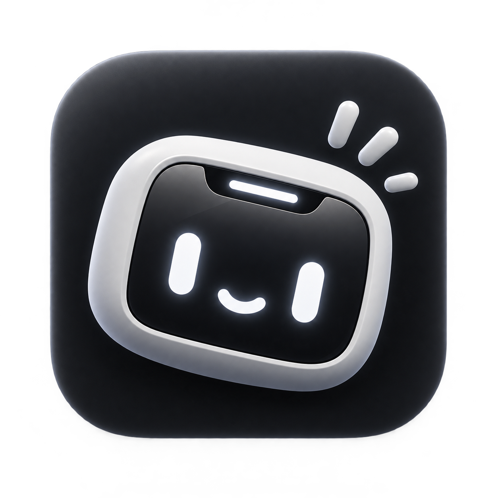
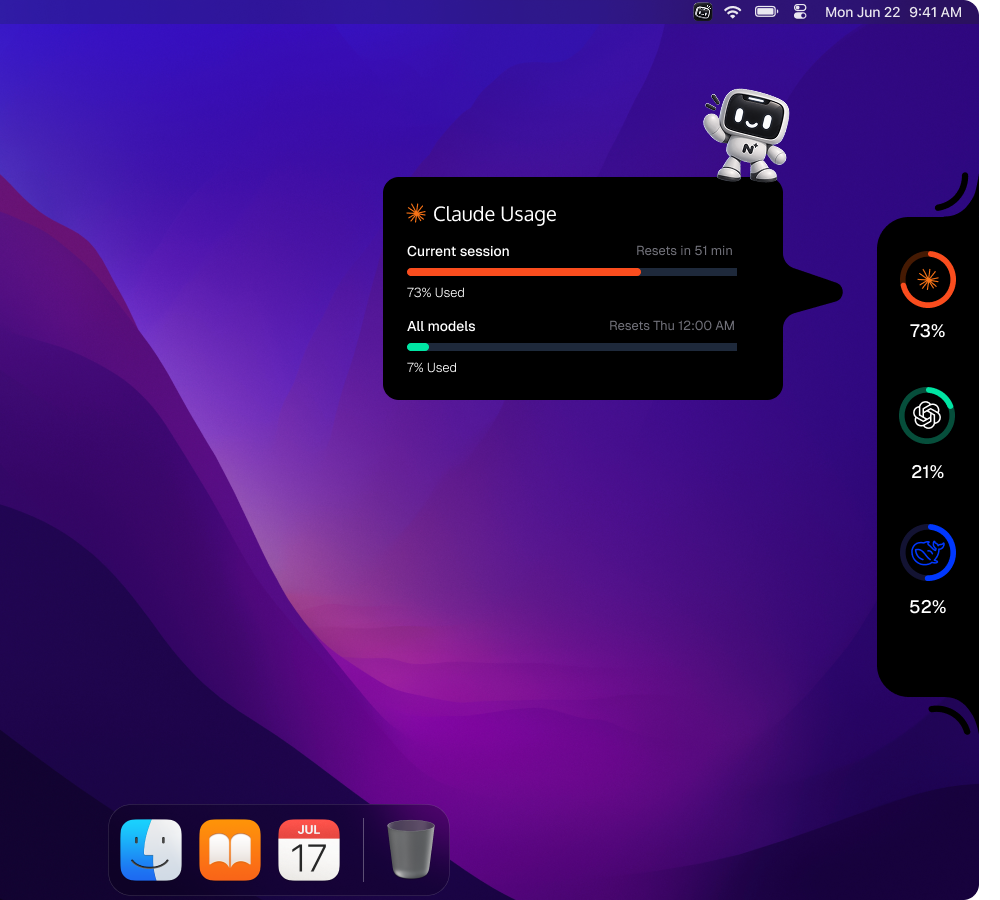

  

  

  <strong>Uma nova forma de perceber o seu trabalho com IA.</strong> 
  Não é só um medidor. É uma pequena presença no seu desktop.

  <a href="https://github.com/ruanJS/Notch-island/releases/latest"><strong>Baixar para Windows</strong></a>
  &nbsp;&nbsp;·&nbsp;&nbsp;
  <a href="https://github.com/ruanJS/Notch-island/releases">Ver versões</a>
  &nbsp;&nbsp;·&nbsp;&nbsp;
  <a href="README-TECHNICAL.md">Documentação técnica</a>

  
  

 

  

## O problema não é a falta de números

Existem muitos medidores de uso. Eles mostram porcentagens, limites e sessões e isso é importante. Mas, na prática, quase todos acabam parecendo a mesma coisa: mais um painel para abrir, consultar e fechar.

O Notch Island começa de outro lugar.

Ele acredita que o estado das suas ferramentas de IA não deveria interromper o seu trabalho. Deveria fazer parte dele de forma natural, quase como uma camada viva do desktop.

## O que é o Notch Island?

O Notch Island é uma ilha de contexto para quem trabalha com várias ferramentas de IA.

Ele transforma informações dispersas uso, limites, sessões e renovações em uma experiência compacta, visual e fácil de interpretar. A ilha fica na borda da tela, acompanha o seu ritmo e aparece com mais detalhes quando você decide olhar.

Você não abre o Notch Island para trabalhar.

Você trabalha e o Notch Island ajuda a manter o contexto por perto.

## Mais do que medir

| Um medidor tradicional | O Notch Island |
| --- | --- |
| Entrega números em uma tela separada. | Cria uma presença que vive junto do seu trabalho. |
| Mostra o estado atual. | Ajuda você a entender o que fazer com esse estado. |
| É funcional, mas facilmente esquecível. | Tem identidade, personalidade e uma linguagem própria. |
| Trata a informação como dado. | Trata a informação como contexto. |
| Termina na métrica. | Começa na métrica e chega à decisão. |

Essa é a diferença central: o Notch Island não quer ser o lugar onde você consulta um número. Ele quer ser o lugar que ajuda você a sentir quando é hora de continuar, mudar de ferramenta ou esperar.

## O Notchi não é um detalhe

O Notchi é o mascote do Notch Island mas, acima de tudo, é a forma como o produto ganha personalidade.

Ele traduz estados abstratos em uma presença que você reconhece. Em vez de transformar cada limite em um alerta frio, o Notchi ajuda a tornar a experiência mais humana, compreensível e memorável.

O objetivo não é criar distração. É criar familiaridade.

Com o tempo, o Notchi deve se tornar a assinatura do produto: um pequeno companheiro que entende o momento da sua rotina e reage a ele com você.

## Uma experiência em quatro movimentos

| 1. Perceber | 2. Entender | 3. Decidir | 4. Continuar |
| --- | --- | --- | --- |
| A ilha está presente sem pedir atenção. | Um olhar revela o estado das suas ferramentas. | Você escolhe se continua, alterna ou espera. | O contexto desaparece e o foco volta para o trabalho. |

O produto foi desenhado para terminar rápido. Quanto menos tempo você precisa passar olhando para ele, melhor ele está fazendo o seu trabalho.

## O que torna a proposta diferente

### Presença, não interrupção

O Notch Island não compete com o aplicativo que você está usando. Ele ocupa um espaço pequeno, permanece acessível e respeita a concentração de quem está criando.

### Contexto, não excesso

Os dados só têm valor quando ajudam a tomar uma decisão. A experiência prioriza leitura rápida e significado antes de transformar tudo em gráficos, abas e configurações.

### Personalidade, não decoração

O Notchi, a linguagem visual e a própria ilha fazem parte do produto. Eles criam uma relação mais próxima com uma categoria que normalmente parece fria e utilitária.

### Evolução, não promessa vazia

O Notch Island está começando, mas sua direção é clara: construir uma experiência de acompanhamento que fique mais inteligente, pessoal e útil à medida que as integrações evoluem.

## Para quem vive entre ferramentas

O Notch Island foi pensado para desenvolvedores, designers, criadores, pesquisadores e equipes que usam IA como parte real do processo não como uma ferramenta isolada.

Para quem alterna entre modelos, sessões e plataformas durante o dia, ele funciona como uma visão contínua do todo. Sem criar mais uma obrigação. Sem pedir que você abandone o fluxo para descobrir onde está.

## Uma ilha que se adapta a você

- **Discreta quando você está concentrado.**
- **Clara quando você precisa decidir.**
- **Expressiva quando o momento pede personalidade.**
- **Personalizável para caber no seu desktop e na sua rotina.**
- **Acompanhada pelo Notchi, que dá significado ao estado da experiência.**

## Comece a conhecer

  

Baixe a versão mais recente, instale e escolha como a ilha deve aparecer no seu desktop. A primeira configuração leva poucos instantes; depois, o Notch Island começa a acompanhar o seu ritmo.

## Onde o produto está agora

O Notch Island está em MVP. A experiência visual, o onboarding, a ilha, a personalização e o mascote já formam a base do produto.

As integrações reais com os provedores de IA serão ampliadas nas próximas versões. Essa evolução será guiada por três compromissos: clareza para o usuário, privacidade por padrão e uma experiência que continue parecendo um produto não apenas uma coleção de métricas.

## Projeto

Este README apresenta a visão e a proposta do produto. Para executar o projeto localmente, conhecer a arquitetura ou contribuir, consulte a [documentação técnica](README-TECHNICAL.md).

## Licença

Este repositório ainda não inclui um arquivo de licença. Consulte o mantenedor antes de copiar, redistribuir ou publicar o projeto.
