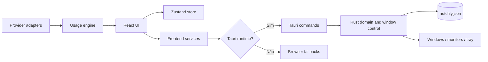
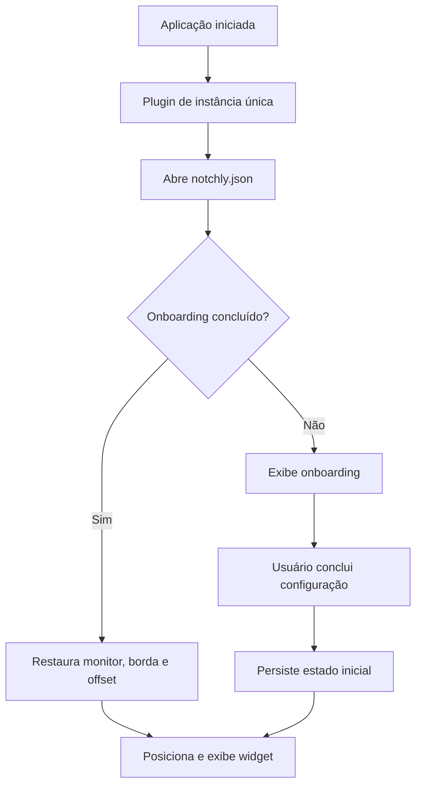

# Notch Island

Companion desktop para acompanhar, em uma única ilha discreta, o consumo das ferramentas de IA usadas no dia a dia.

O Notch Island combina uma interface React com uma camada nativa em Tauri/Rust. O aplicativo vive na borda da tela, apresenta o uso por provedor, abre detalhes sob demanda e preserva a posição do widget entre execuções.

> [!IMPORTANT]
> O projeto está em fase de MVP. A interface, o onboarding, o posicionamento nativo, a bandeja do sistema e a personalização visual estão implementados. Os dados de consumo ainda são fornecidos por adapters mockados; não há autenticação nem coleta real nas APIs dos provedores nesta versão.

## Visão geral

O produto foi desenhado para responder rapidamente a três perguntas:

- quanto da cota de cada ferramenta já foi consumido;
- quando a sessão ou o período será renovado;
- qual provedor está mais próximo do limite.

A experiência é dividida em janelas especializadas. O onboarding cuida da primeira execução, o widget permanece sobre o desktop, as configurações concentram preferências e uma camada transparente auxilia na escolha da borda da tela.

## Funcionalidades

### Disponível no MVP

- onboarding guiado em nove etapas;
- controles de seleção de provedores no onboarding e nas configurações;
- widget transparente, sem decoração e sempre no topo;
- visualização compacta de consumo e flyout com detalhes do provedor;
- posicionamento nativo nas bordas superior, inferior, esquerda ou direita;
- seleção visual de posição por overlay e ponteiro;
- suporte a múltiplos monitores, coordenadas negativas e diferentes escalas de DPI;
- redimensionamento nativo sincronizado com o conteúdo React;
- restauração da posição do widget entre execuções;
- temas Obsidian, Midnight, Cyberpunk, Emerald e Amber;
- superfícies sólida, translúcida e glass blur;
- fontes Inter, JetBrains Mono, Outfit e Plus Jakarta Sans;
- cores personalizadas por provedor;
- inicialização automática com o Windows;
- instância única da aplicação;
- menu na bandeja para mostrar, ocultar e abrir configurações;
- modo de preview no navegador para desenvolvimento de interface.

### Ainda não implementado

- integração real com Claude, ChatGPT, Gemini, Codex, Cursor ou Antigravity;
- autenticação e gerenciamento de credenciais de provedores;
- persistência e sincronização entre janelas das preferências visuais e da seleção de provedores;
- notificações nativas de limite e renovação;
- comportamento funcional para `Pause Tracking` no menu da bandeja;
- navegação direta para a aba de provedores a partir da bandeja;
- ativação completa do mascote Notchi com dados reais;
- empacotamento e validação oficial para macOS ou Linux.

## Stack

| Camada | Tecnologia | Responsabilidade |
| --- | --- | --- |
| Interface | React 19 + TypeScript | Onboarding, widget, configurações e componentes visuais |
| Build web | Vite 8 | Servidor de desenvolvimento e bundle do frontend |
| Desktop | Tauri 2 | Janelas, comandos nativos, tray, ciclo de vida e empacotamento |
| Backend nativo | Rust 2021 | Geometria, monitores, persistência e integração com o sistema |
| Estado | Zustand 5 | Estado compartilhado em memória entre componentes da mesma janela |
| Movimento | Framer Motion + GSAP | Transições e interações visuais |
| Ícones | Lucide React + SVGs locais | Iconografia da interface |
| Persistência nativa | Tauri Store | Onboarding e posição do widget |

## Arquitetura



### Princípios adotados

- **UI sem IPC direto:** componentes chamam services; os services encapsulam `invoke` e os fallbacks de navegador.
- **Domínio independente:** cálculos de consumo e resolução de estado do Notchi não dependem de React ou Tauri.
- **Geometria nativa como fonte de verdade:** Rust converte pixels lógicos em físicos, respeita a área útil do monitor e mantém o widget dentro da tela.
- **Janelas por responsabilidade:** cada label Tauri renderiza uma raiz React específica.
- **Adapters substituíveis:** o contrato `AIProvider` permite trocar o mock por integrações reais sem acoplar a UI aos provedores.

## Janelas da aplicação

| Label | Estado inicial | Finalidade |
| --- | --- | --- |
| `onboarding` | Visível na primeira execução | Configuração inicial do produto |
| `widget` | Oculta até concluir o onboarding | Ilha flutuante e sempre no topo |
| `settings` | Oculta | Preferências visuais, posição e provedores |
| `placement` | Criada pelo backend | Overlay transparente para escolher a borda |
| `main` | Oculta/reservada | Janela declarada para evolução futura |

O roteamento ocorre em `src/app/App.tsx`. Durante o desenvolvimento web, a janela pode ser simulada com o parâmetro `?window=`:

```text
http://localhost:1420/?window=onboarding
http://localhost:1420/?window=widget
http://localhost:1420/?window=settings
http://localhost:1420/?window=placement
```

O preview no navegador serve para validar a interface. Recursos como posicionamento de janela, bandeja, autostart e persistência via Tauri Store só podem ser validados no aplicativo nativo.

## Fluxo de inicialização



Ao abrir uma segunda instância, o processo já ativo recebe foco e reexibe o widget.

## Posicionamento e geometria

O widget não trata coordenadas CSS como coordenadas absolutas do sistema. A interface mede o canvas transparente e o dock visível; em seguida, envia um `WidgetBoundsRequest` para o backend.

O backend:

1. identifica o monitor ativo;
2. lê a área útil, descontando elementos como a barra de tarefas;
3. converte uma única vez os valores lógicos para pixels físicos;
4. limita tamanho e deslocamento à área disponível;
5. aplica a posição na borda selecionada;
6. persiste `placement`, `edge`, `offset` e `monitor_id`;
7. emite `widget-position-changed` para sincronizar o React.

As posições públicas atuais são `TOP_CENTER`, `BOTTOM_CENTER`, `LEFT_CENTER` e `RIGHT_CENTER`. O backend também reconhece registros antigos de canto e os migra para o centro da borda correspondente.

## Providers e consumo

O contrato principal está em `src/providers/domain/types.ts`:

```ts
interface AIProvider {
  id: string;
  name: string;
  icon?: string;
  color?: string;
  fetchUsage(): Promise<UsageSnapshot>;
  fetchLimits(): Promise<UsageLimit[]>;
}
```

Atualmente, `ProviderService` registra apenas `MockProvider`. Os snapshots são estáticos e existem para desenvolver a experiência de uso. Eles não representam a conta ou o consumo real do usuário.

Para adicionar um provider real:

1. implemente `AIProvider` em `src/providers/adapters/`;
2. converta a resposta externa para `UsageSnapshot` e `UsageLimit`;
3. registre o adapter em `ProviderService`;
4. mantenha autenticação, erros e renovação de sessão fora dos componentes React;
5. adicione testes para normalização, limites ausentes e respostas parciais;
6. documente explicitamente quais dados saem da máquina.

`UsageEngine` centraliza cálculos determinísticos, como percentual, saldo restante, estouro de limite e estimativa de esgotamento. A UI não deve duplicar essas regras.

## Notchi

Notchi é a camada visual de estado do produto. O resolver puro converte o maior percentual de uso em um dos estados:

| Faixa | Estado |
| --- | --- |
| 0–40% | `happy` |
| 40–60% | `normal` |
| 60–75% | `watching` |
| 75–90% | `concerned` |
| 90–99% | `critical` |
| 99–100% | `exhausted` |

As regras são extensíveis, mas o mascote ainda está sinalizado na interface como uma evolução futura até que os providers reais estejam conectados.

## Persistência

### Persistido no Tauri Store

O arquivo lógico `notchly.json` armazena:

- `hasCompletedOnboarding`;
- `widgetPosition`;
- `widgetEdgeOffsetV1`, marcador da versão atual do layout.

### Estado somente em memória

O store Zustand ainda não usa middleware de persistência. Tema, superfície, fonte, orientação, cores, providers selecionados e estado do Notchi voltam aos defaults ao reiniciar o processo ou ao abrir outra janela isolada.

### Fallback de navegador

O preview usa `localStorage` para partes do onboarding e do layout. Esse fallback existe para desenvolvimento e não replica todas as garantias do runtime nativo.

> [!NOTE]
> Os identificadores `notchly.json`, `notchly:*`, o package Rust `notchly` e o bundle identifier `com.notchly.app` foram preservados por compatibilidade. O nome apresentado ao usuário é **Notch Island**.

## Estrutura do projeto

```text
notch-island-app/
├── public/                     # Assets servidos diretamente pelo Vite
├── src/
│   ├── app/                    # Bootstrap, roteamento por janela e store global
│   ├── assets/                 # Imagens e SVGs importados pelo frontend
│   ├── components/             # Componentes genéricos
│   ├── notchi/                 # Componente e regras de estado do mascote
│   ├── onboarding/             # Fluxo da primeira execução
│   ├── providers/              # Contratos, adapters e serviço de providers
│   ├── settings/               # Janela e serviços de configurações
│   ├── shared/                 # Infraestrutura compartilhada e ícones
│   ├── styles/                 # Estilos globais
│   ├── usage/                  # Regras determinísticas de consumo
│   └── widget/                 # Ilha, flyout, posicionamento e interações
├── src-tauri/
│   ├── capabilities/           # Permissões das janelas Tauri
│   ├── icons/                  # Ícones dos bundles desktop
│   └── src/
│       ├── commands/           # API IPC exposta ao frontend
│       ├── platform/windows/   # Adaptação nativa para Windows
│       ├── storage/            # Inicialização do estado persistido
│       ├── tray/               # Ícone e menu da bandeja
│       └── lib.rs              # Composição da aplicação Tauri
├── package.json
├── vite.config.ts
└── README.md
```

## Pré-requisitos

O runtime nativo está implementado e validado para Windows.

- Windows 10 ou 11;
- Node.js `^20.19.0` ou `>=22.12.0`;
- npm;
- Rust com toolchain MSVC;
- Microsoft C++ Build Tools com o workload de desenvolvimento para desktop;
- WebView2 Runtime.

Consulte os [pré-requisitos oficiais do Tauri](https://v2.tauri.app/start/prerequisites/) para preparar o ambiente.

## Instalação

```powershell
git clone <url-do-repositorio>
cd notch-island-app
npm ci
```

Confirme o ambiente antes de iniciar:

```powershell
node --version
npm --version
rustc --version
cargo --version
```

O projeto não utiliza arquivo `.env` nesta versão.

## Desenvolvimento

### Aplicação desktop

```powershell
npm run tauri dev
```

Esse comando inicia o Vite na porta `1420`, compila a camada Rust e abre as janelas gerenciadas pelo Tauri.

### Interface no navegador

```powershell
npm run dev
```

Acesse uma das URLs com `?window=` descritas na seção de janelas. A porta é estrita: se `1420` já estiver em uso, encerre o servidor anterior antes de iniciar outro.

### Preview do bundle web

```powershell
npm run build
npm run preview
```

## Qualidade e validação

### TypeScript e bundle do frontend

```powershell
npm run build
```

O script executa `tsc` em modo estrito e, depois, gera o bundle de produção com Vite.

### Testes Rust

```powershell
cargo test --manifest-path src-tauri/Cargo.toml
```

Os testes nativos cobrem limites de tela, DPI, coordenadas negativas, mudança de tamanho, preservação da borda e seleção de posição.

Se o checkout foi movido ou copiado e o Cargo tentar acessar um caminho antigo, use um target isolado:

```powershell
$env:CARGO_TARGET_DIR = Join-Path $env:TEMP "notch-island-target"
cargo test --manifest-path src-tauri/Cargo.toml
```

### Checklist manual nativo

Uma build verde não comprova o comportamento visual das janelas. Antes de publicar, valide no runtime Tauri:

- primeira execução e conclusão do onboarding;
- restauração do widget após reiniciar;
- quatro bordas e múltiplos monitores;
- escalas de 100%, 125% e 150%;
- expansão e recolhimento por hover;
- abertura e fechamento do flyout;
- overlay de reposicionamento;
- abertura das configurações pelo widget e pela bandeja;
- autostart habilitado e desabilitado;
- encerramento completo pelo menu da bandeja.

## Build e empacotamento

Para gerar o bundle configurado pelo Tauri:

```powershell
npm run tauri build
```

Para gerar somente o instalador NSIS no Windows:

```powershell
npm run tauri build -- --bundles nsis
```

Os artefatos são gravados por padrão em:

```text
src-tauri/target/release/bundle/
```

Se a compilação informar `Access is denied` ao substituir o executável, verifique se uma instância local do Notch Island ainda está aberta na bandeja e encerre apenas esse processo antes de recompilar.

## Comandos IPC

| Comando | Responsabilidade |
| --- | --- |
| `get_widget_position` | Lê e normaliza a posição persistida |
| `update_widget_bounds` | Sincroniza tamanho do canvas e posição nativa |
| `set_widget_placement` | Move o widget para uma borda predefinida |
| `place_widget_from_pointer` | Resolve a posição a partir do ponteiro |
| `begin_widget_placement` | Inicia o overlay de reposicionamento |
| `show_widget` / `hide_widget` | Controla a visibilidade do widget |
| `open_settings` / `close_settings` | Controla a janela de configurações |
| `enable_startup` / `disable_startup` | Configura autostart |
| `is_startup_enabled` | Consulta o estado do autostart |
| `complete_onboarding` | Persiste a conclusão e abre o widget |
| `has_completed_onboarding` | Consulta o estado da primeira execução |

As capabilities atuais concedem às janelas apenas permissões core padrão e início de arraste de janela. Novos plugins devem declarar somente as permissões necessárias.

## Privacidade e segurança

- não há backend remoto próprio nesta versão;
- não há armazenamento de tokens ou credenciais de provedores;
- a posição e o estado do onboarding ficam no armazenamento local do Tauri;
- o HTML carrega fontes do Google Fonts, portanto a aplicação não é totalmente offline;
- a Content Security Policy está desabilitada (`csp: null`) durante o estágio atual do MVP.

Antes de integrar providers reais, defina uma política de credenciais, habilite uma CSP restritiva, minimize o escopo de permissões e documente cada comunicação externa. Segredos não devem ser expostos ao bundle React nem gravados em texto puro.

## Convenções para contribuição

- mantenha regras de domínio fora dos componentes visuais;
- adicione chamadas nativas por meio de um service, não diretamente na UI;
- trate o backend Rust como autoridade para geometria de janelas;
- preserve compatibilidade dos dados persistidos ou implemente uma migração explícita;
- não apresente dados mockados como consumo real;
- valide frontend e Rust antes de abrir uma mudança;
- descreva separadamente o que foi validado em build, teste automatizado e execução nativa.

Fluxo sugerido:

```powershell
npm ci
npm run build
cargo test --manifest-path src-tauri/Cargo.toml
npm run tauri dev
```

## Roadmap técnico

- substituir `MockProvider` por adapters reais e isolados;
- definir autenticação segura e consentimento explícito por integração;
- persistir preferências compartilhadas entre janelas;
- implementar atualização, retry e estados de erro dos providers;
- ativar alertas e notificações configuráveis;
- conectar Notchi a snapshots reais e testados;
- dividir o bundle frontend com carregamento por janela;
- otimizar assets de imagem;
- habilitar CSP compatível com os recursos necessários;
- ampliar testes unitários do domínio e testes end-to-end do runtime nativo;
- concluir a estratégia multiplataforma antes de anunciar suporte fora do Windows.

## Licença

Este repositório não inclui um arquivo de licença. Consulte o mantenedor antes de copiar, redistribuir ou publicar o projeto.
